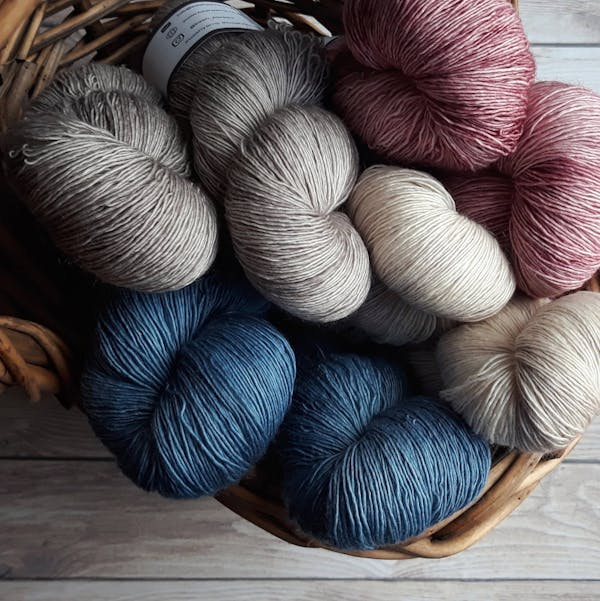

<div align="center">

<!-- VISUAL SUGGESTION: Replace the banner below with a high-resolution hero image
     (1280x640 px) showing Indian shepherds, handcrafted wool, or an app screenshot montage.
     Tools like Canva, Figma, or Adobe Express work well for creating a branded banner. -->



<br/><br/>

# 🐑 WoolConnect

### *Empowering India's Wool Ecosystem — From Pasture to Premium Market*

**A comprehensive digital platform connecting shepherds, traders, artisans, and buyers across India's ₹5,000-crore wool industry.**

<br/>

[](https://vishantrathi.github.io/woolconnect/)
[](https://github.com/vishantrathi/woolconnect/stargazers)
[](https://github.com/vishantrathi/woolconnect/network/members)
[](https://github.com/vishantrathi/woolconnect/graphs/contributors)

</div>

---

## 🌟 About WoolConnect

> *"Bridging the gap between India's pastoral heritage and the demands of the modern wool economy."*

India is home to one of the world's largest sheep populations — yet millions of shepherds, artisans, and small-scale wool producers remain disconnected from fair markets, quality infrastructure, and the knowledge they need to unlock the true value of their craft.

**WoolConnect** is a mission-driven agritech platform built to change that.

We deliver an integrated digital ecosystem that empowers every stakeholder in India's wool value chain — from the shepherd in Rajasthan's arid plains to the handloom artisan in Himachal Pradesh, and from regional traders to global buyers. With real-time market intelligence, end-to-end traceability, and access to processing services and education, WoolConnect is redefining how India's wool economy operates.

<!-- VISUAL SUGGESTION: Add a 3-panel infographic here illustrating the journey:
     Shepherd → Processing → Market. Simple, branded visuals significantly boost credibility. -->

---

## ✨ Platform Features

### 📈 Market Intelligence
> **Stay ahead of the market with precision data.**

Real-time wool price updates, regional market trends, policy news, and demand forecasts — all in one intuitive dashboard. Make informed, data-backed decisions rather than relying on word-of-mouth estimates.

---

### 🛰️ End-to-End Wool Traceability
> **Full visibility from farm to final product.**

Track every bale of wool through its complete journey — from shearing on the farm through processing units to final delivery. Build buyer confidence and command premium pricing with transparent, verifiable supply chain records.

---

### ✅ Quality Assurance & Grading
> **Unlock premium prices through certified quality.**

Access professional wool grading services and quality assessment tools that help producers understand and elevate their fleece standards. Standardised quality benchmarks open pathways to higher-value markets and export opportunities.

---

### 🏛️ Storage & Warehousing Solutions
> **Reduce losses. Manage inventory intelligently.**

Connect to verified storage and warehousing facilities across key wool-producing regions. Monitor stock health, manage inventory digitally, and reduce post-harvest losses with smart warehousing solutions designed for the Indian wool trade.

---

### ✂️ Wool Processing Services
> **From raw fleece to refined fibre — seamlessly.**

Discover and connect with service providers for shearing, sorting, scouring, carding, spinning, and dyeing. WoolConnect aggregates the processing ecosystem so producers can move wool from raw to ready-for-market with confidence and efficiency.

---

### 🤝 Direct Wool Trading Platform
> **Direct trade. Better margins. Zero middlemen.**

A transparent, peer-to-peer trading platform where wool producers list, negotiate, and sell directly to buyers — eliminating unnecessary intermediaries and ensuring fair, market-linked prices for the farmer.

---

### 🛍️ Online Wool Marketplace
> **India's dedicated digital marketplace for wool.**

Browse and source wool varieties from verified producers across India. Buyers get access to graded wool at competitive prices; sellers gain national and international reach without leaving their communities.

<!-- VISUAL SUGGESTION: Add a screenshot of the marketplace UI here. Annotate it with
     callouts highlighting key features — this adds immediate visual proof of the product. -->

---

### 🎓 Wool Education & Skill Development Hub
> **Knowledge is the foundation of quality.**

A rich resource library featuring training modules, best practices, and region-specific guidance for wool production, quality improvement, design innovation, and marketing. Content is tailored by state and region to reflect the diversity of India's local wool varieties and artisan traditions.

---

## 🇮🇳 Our Impact on India's Wool Sector

India produces approximately **52 million kg of wool annually**, yet a significant share of its economic value is lost to fragmented markets, lack of quality infrastructure, and information asymmetry. WoolConnect directly addresses these systemic gaps.

<!-- VISUAL SUGGESTION: Add a map of India here highlighting major wool-producing states
     (Rajasthan, J&K, Himachal Pradesh, Uttarakhand, Gujarat, Karnataka).
     A visual of WoolConnect's geographic reach adds strong credibility to this section. -->

| Stakeholder | How WoolConnect Helps |
|---|---|
| 🐑 **Shepherds & Farmers** | Fair prices, direct market access, storage, and income stability |
| 🧵 **Artisans & Weavers** | Quality raw material sourcing, design resources, and skill development |
| 🏬 **Traders & Aggregators** | Streamlined procurement, verified quality grading, and digital records |
| 🏛️ **Government & NGOs** | Data-driven policy support, rural employment, and scheme dissemination |
| 🌍 **Buyers & Exporters** | Traceable, certified, premium Indian wool at scale |

---

## 🚀 Getting Started

Experience WoolConnect in minutes:

1. **Explore the Live Platform** → [vishantrathi.github.io/woolconnect](https://vishantrathi.github.io/woolconnect/)
2. **Fork & clone** the repository to run it locally (see the contribution guide below)
3. **Install dependencies** as described in `requirements.txt` or the project setup guide
4. **Run locally** and explore the full feature set on your machine

```bash
git clone https://github.com/vishantrathi/woolconnect.git
cd woolconnect
# Follow setup instructions in requirements.txt or the setup guide
```

---

## 🤝 Contributing to WoolConnect

> ⭐ **Please star the repository before submitting a Pull Request.** Your support helps us grow and reach more stakeholders across India.

We welcome contributions from developers, designers, domain experts, and anyone passionate about rural technology and India's fibre economy. Here's how to get involved:

**1. Fork the Repository**
Click **Fork** at the top-right of this page to create your personal copy.

**2. Clone Your Fork**
```bash
git clone https://github.com/<your-username>/woolconnect.git
```

**3. Create a Feature Branch**
```bash
git checkout -b feature/your-feature-name
```

**4. Make Your Changes**
Build new features, fix bugs, or improve documentation. Keep your code clean, well-commented, and efficient.

**5. Commit with Clarity**
```bash
git commit -m "feat: add [feature name] — brief description of change"
```

**6. Push Your Branch**
```bash
git push origin feature/your-feature-name
```

**7. Open a Pull Request**
Navigate to the original repository and click **New Pull Request**. Describe your changes clearly and reference any related issues.

---

## 🎯 Contribution Standards

We hold our codebase to a high standard. Before submitting, please ensure:

| Standard | Expectation |
|---|---|
| 📖 **Clarity** | Code is well-documented, logically structured, and consistently formatted |
| ⚡ **Efficiency** | Algorithms are optimised; include explanations for non-trivial optimisations |
| 🧹 **Readability** | Code is clean, self-explanatory, and accessible to all contributors |
| 🧪 **Quality** | All new features and fixes are thoroughly tested before submission |

---

## 💼 Partner With Us

WoolConnect is actively seeking partnerships with:

- 🏛️ **Government bodies** — CWDB, state wool development boards, and rural livelihood missions
- 🏢 **NGOs & Self-Help Groups** — working with shepherds, weavers, and pastoral communities
- 🏦 **Investors & Agritech Funds** — committed to sustainable rural technology in India
- 🌍 **Global Wool Buyers** — looking for traceable, ethically sourced Indian wool

> 📩 Interested in partnering? [Open an issue](https://github.com/vishantrathi/woolconnect/issues) or connect through our live platform.

---

## 👥 Project Contributors

<div align="center">

<a href="https://github.com/vishantrathi/woolconnect/graphs/contributors">
  
</a>

</div>

---

## ⭐ Starred By

<div align="center">

[](https://github.com/vishantrathi/woolconnect/stargazers)

</div>

## 🍴 Forked By

<div align="center">

[](https://github.com/vishantrathi/woolconnect/network/members)

</div>

---

<div align="center">

**Built with dedication for India's shepherds, artisans, and wool entrepreneurs.**

*WoolConnect — Where tradition meets technology.* 🐑🧶

[](https://vishantrathi.github.io/woolconnect/)

</div>
